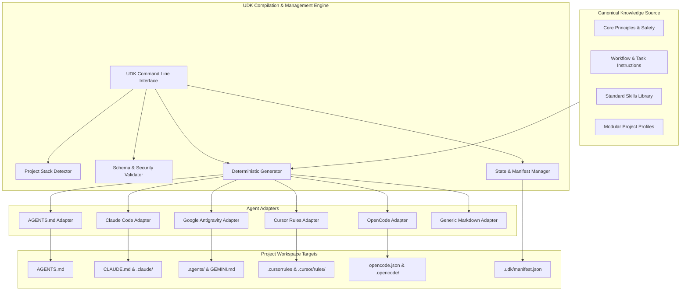

# Universal AI Dev Kit: System Architecture

**Document Version:** 1.0.0  
**Status:** Approved Architecture

---

## 1. System Overview

The **Universal AI Dev Kit** (`udk`) follows a **Compiler / Adapter Architecture**. Canonical engineering rules and skills reside in a structured, model-neutral repository. The UDK compilation engine processes these canonical sources alongside project profiles and emits native, deterministic configuration files for selected AI coding agents.



---

## 2. Core Entities and Definitions

To maintain architectural integrity, concepts are strictly separated:

1. **Core Principle (`udk.core.principles`)**:
   * Fundamental, universal software engineering standards (e.g. read before edit, minimal coherent changes, no secrets in code, deterministic validation). Universal to all languages and projects.
2. **Instruction (`udk.core.instructions`)**:
   * Scoped procedural guidance for specific engineering tasks (e.g., planning, implementation, debugging, testing, code review, documentation).
3. **Skill (`udk.core.skills`)**:
   * A discrete, reusable capability specified via standard `SKILL.md` (frontmatter: `name`, `description`, `version`, `tags`) outlining repeatable steps, safety boundaries, required inputs, and expected outputs.
4. **Workflow (`udk.core.workflows`)**:
   * Multi-step operational guides (e.g., release preparation, dependency upgrade, incident response).
5. **Project Profile (`udk.core.profiles`)**:
   * A curated package of instructions, conventions, and skills tailored to a domain (e.g. `python`, `web`, `desktop`, `mobile`, `ai-ml`, `research`).
6. **Agent Adapter (`udk.adapters.base.AgentAdapter`)**:
   * A translator that formats canonical instructions, profiles, and skills into the native file layout and syntax expected by a target agent (e.g., compiling into `.cursor/rules/*.mdc` with frontmatter globs or compiling into `CLAUDE.md`).
7. **Template (`udk.templates`)**:
   * Optional starter files (e.g. baseline configuration, directory scaffolding) provided when bootstrapping a brand new project.
8. **Validation Rule (`udk.validator`)**:
   * An executable check that validates filesystem paths, JSON/YAML schemas, link integrity, or configuration drift.
9. **Configuration Manifest (`.udk/manifest.json`)**:
   * The machine-readable state of an installed project, recording installed profiles, target adapters, owned file paths, content SHA-256 hashes, and version.

---

## 3. Python Package Modular Architecture

The toolkit is structured as a standard Python package (`udk`):

```
udk/
├── __init__.py
├── __main__.py             # Entrypoint for `python -m udk`
├── cli.py                  # CLI argument parser and command router
├── detector.py             # Heuristics for discovering project stack & files
├── manifest.py             # Manifest state management, checksums, drift detection
├── canonical/              # Canonical knowledge files packaged with the toolkit
│   ├── core/
│   │   ├── principles.md
│   │   ├── engineering.md
│   │   ├── workflow.md
│   │   └── safety.md
│   ├── instructions/
│   │   ├── planning.md
│   │   ├── implementation.md
│   │   ├── debugging.md
│   │   ├── testing.md
│   │   ├── code_review.md
│   │   └── documentation.md
│   ├── profiles/
│   │   ├── python.yaml
│   │   ├── web.yaml
│   │   ├── desktop.yaml
│   │   ├── mobile.yaml
│   │   ├── ai_ml.yaml
│   │   └── research.yaml
│   └── skills/
│       ├── research/
│       ├── requirements/
│       ├── exploration/
│       ├── architecture_review/
│       ├── incremental_impl/
│       ├── debugging/
│       ├── test_planning/
│       ├── code_review/
│       ├── security_review/
│       ├── doc_maintenance/
│       ├── dependency_review/
│       └── release_prep/
├── adapters/
│   ├── __init__.py
│   ├── base.py             # Base abstract adapter class
│   ├── agents_md.py        # AGENTS.md compiler
│   ├── claude_code.py      # CLAUDE.md compiler
│   ├── antigravity.py      # Google Antigravity (.agents/) compiler
│   ├── cursor.py           # Cursor (.cursorrules / .cursor/rules/) compiler
│   ├── opencode.py         # OpenCode (opencode.json) compiler
│   └── generic.py          # Plain Markdown export
├── validator/
│   ├── __init__.py
│   ├── engine.py           # Core validation engine
│   ├── schema.py           # Schema rules
│   └── security.py         # Path traversal and safety checks
└── generator/
    ├── __init__.py
    └── engine.py           # Deterministic rendering pipeline
```

---

## 4. Key Execution Workflows

### 4.1 Initialization Flow (`udk init`)
1. **Target Inspection**: Check if target directory exists; scan for project marker files (`pyproject.toml`, `package.json`, etc.).
2. **Profile & Adapter Resolution**: Match user arguments or heuristic recommendations.
3. **Plan Generation**: Compute planned files and destination paths.
4. **Collision Detection**: Compare planned paths with existing files:
   * If existing file is already managed by UDK and unchanged: overwrite/update cleanly.
   * If existing file is user-created or modified: warn and prompt or require explicit flag.
5. **Deterministic Write**: Write files with standardized header banners (`Generated by Universal AI Dev Kit - Do Not Edit Directly unless disconnecting`).
6. **Manifest State Commit**: Write `.udk/manifest.json` with file paths and SHA-256 hashes.

### 4.2 Safe Update Flow (`udk update`)
1. **Load Manifest**: Read `.udk/manifest.json` to identify previously generated files.
2. **Drift Detection**: Compute SHA-256 of current files against manifest hashes.
   * Unchanged: Safe to update with new version.
   * Modified by User: Mark as conflict. Display unified diff.
3. **Dry-Run Inspection**: Support `--dry-run` to output changes without touching disk.
4. **Update**: Re-render updated canonical templates into target paths; update manifest.

### 4.3 Safe Removal Flow (`udk remove`)
1. **Load Manifest**: Read list of managed files.
2. **Integrity Check**: Ensure each file matches its manifest hash or belongs strictly to the managed list.
3. **Confirmation**: Delete managed files. Remove `.udk/` directory.
4. **Preservation**: Never touch files outside the manifest.

---

## 5. Security & Isolation Architecture

* **Path Normalization**: All relative file targets are converted using `os.path.realpath` and asserted to reside strictly inside the workspace root:
  ```python
  if not resolved_path.startswith(project_root):
      raise SecurityError(f"Path traversal detected: {path}")
  ```
* **No Dynamic Shell Execution in Generator**: Adapter generation is pure file compilation. No shell commands or subprocesses are executed when generating or validating configs.
* **Secret Masking & Policy**: The canonical safety principles embed explicit instructions warning agents against writing or committing secrets (`.env`, tokens, private keys).
